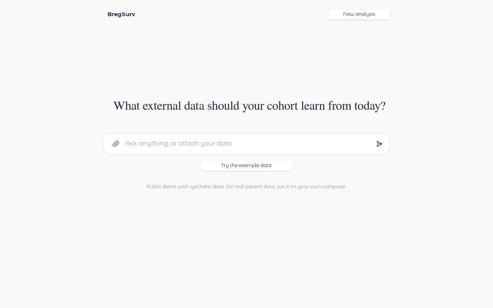
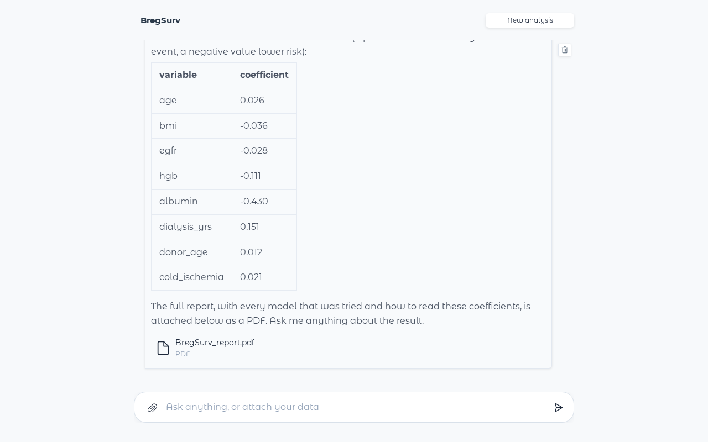
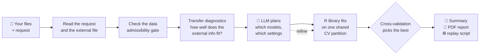

<div align="center">

# 🧬 BregSurv Agent

**A local AI agent for survival analysis that learns from external data — published models or other cohorts — and only when it helps.**

[](https://huggingface.co/spaces/anon-bregsurv/BregSurv)
[](https://www.r-project.org/)
[](https://www.python.org/)
[-6f42c1)](https://huggingface.co/Qwen/Qwen3-8B-AWQ)
[](LICENSE.md)


<sub>▶️ Full demo video: <a href="assets/demo.mp4">assets/demo.mp4</a></sub>

</div>

---

## 📖 Overview

You have a **cohort** — a few hundred patients from your hospital — and someone else has **more data**: a published risk model from a national registry, or another centre's patient records. Borrowing from that external information can make your survival analysis far more precise. Borrowing blindly can also make it worse, because the external population is never quite yours.

**BregSurv Agent** does this analysis for you from a single sentence:

> *"Follow-up is in `followup_days`, `died` is 1 when the patient died. Adjust for age, BMI, eGFR, haemoglobin, albumin, dialysis years, donor age and cold ischaemia time. We also have coefficients from a registry model — borrow from them if that helps."*

It reads your request and your files, checks how well the external information fits your data, plans which analyses are worth running, fits them, and lets cross-validation decide — including the two honest baselines, **your data alone** and **the external model as it is**. You get a plain-language answer in the chat and a full PDF report.

🔒 **Everything runs on your own machine.** The language model (Qwen3-8B) is served locally; no patient row ever leaves your computer, and no external API is called.

---

## ✨ Why BregSurv Agent?

| | |
|---|---|
| 🎯 **Borrows only when it helps** | Your data alone and the external model unchanged are always in the comparison, so the agent can — and does — tell you when borrowing does *not* pay. |
| 🧠 **The LLM plans, the statistics decide** | The model reads diagnostics of how your data and the external information agree and plans the analysis; a verified R estimator library fits it; cross-validation picks the winner. |
| 🔢 **No number is written by the model** | Every estimate in the chat and the report is inserted from the fitted objects. The model writes words, never digits. |
| ♻️ **Fully reproducible** | Each run ships a script that reproduces the analysis from the R library alone, with no language model involved. |
| 💬 **Made for clinicians** | Drop files into the chat and describe the analysis in your own words. The agent asks only what the data cannot tell it. |
| 🖥️ **Small and local** | An 8B model on a single GPU (≥ 16 GB). No cloud account, no API key, no data transfer. |

---

## 🚀 Quick Start

### Option 1 — Try it online (no installation)

Open the **[Hugging Face Space](https://huggingface.co/spaces/anon-bregsurv/BregSurv)** and click **Try the example data**. The demo uses synthetic data only; for real patient data, run it locally.

### Option 2 — Run it on your own GPU (recommended for real data)

You need [Docker](https://docs.docker.com/get-docker/) with the [NVIDIA Container Toolkit](https://docs.nvidia.com/datacenter/cloud-native/container-toolkit/) and a GPU with at least 16 GB of memory.

```bash
git clone https://github.com/UM-KevinHe/BregSurv.git
cd BregSurv
docker build -t bregsurv-agent .
docker run --gpus all -p 7860:7860 bregsurv-agent
```

Open **http://localhost:7860**. The first start takes a few minutes while the model loads. The same chat interface as the online demo runs entirely on your machine — your data stays there. Settings, and running without Docker or without any language model, are in [`deploy/DEPLOY.md`](deploy/DEPLOY.md).

### Option 3 — Use the R package directly

The estimator library behind the agent is a standalone R package with one interface for every analysis:

```r
# install.packages("remotes")
remotes::install_github("UM-KevinHe/BregSurv")
library(BregSurv)
fit <- cv.bregsurv(target  = target_cox(time, event, z),
                   release = release_coef(beta_registry),   # what the external source published
                   member  = "kl")                          # how it enters the objective
```

See [the R package](#-the-r-package-one-bregman-divergence-objective) below and the
[package website](https://um-kevinhe.github.io/BregSurv/).

---

## 💬 How a conversation goes

1. **Drop your files** into the message box (📎): your cohort (`.csv`, `.xlsx`, `.rds`, …) and, optionally, the external information — a coefficient table, a JSON with coefficients and covariance, a baseline-hazard table, or another cohort's records. A second file with the same columns can be your **test set**.
2. **Say what you want** in plain words. Name the follow-up time, the event, and what to adjust for.
3. **Watch it work.** The chat shows each step as it happens:

   ```
   ✓ Reading your request
   ✓ Finding the columns you named
   ✓ Checking your data
   ✓ Checking how well the external data fits your cohort
   ✓ Planning which models to fit
   ✓ Fitting the planned models
   ✓ Comparing the models and choosing the best
   ✓ Writing the report
   ```

4. **Read the answer.** A short summary in the chat — what was compared, whether borrowing helped, and the coefficients of the recommended model — with the **full PDF report** attached.
5. **Ask follow-up questions** — *"Why was that model chosen instead of just using my own data?"* — and get plain-language answers grounded in the fitted results.

<div align="center">
 &nbsp; 
</div>

---

## 🧭 How it works



* **The harness gathers, the model decides.** Deterministic code profiles your data, verifies every reading against your own words and your file, and computes the diagnostics. The language model uses them to plan *what* to fit; it never sets a number.
* **Every plan is checked.** Only analyses the data admit can be fitted, the two do-not-borrow baselines are always included, and a fixed computing budget bounds the plan.
* **Cross-validation decides**, on one partition shared by every candidate, so the comparison is fair.

---

## 📦 The R package: one Bregman-divergence objective

### One objective, three decisions

Every estimator in the package minimizes

$$
Q_\eta(\theta) = -\ell(\theta) + \eta\,\mathcal{B}_G(\theta), \qquad \eta \ge 0,
$$

where $\ell$ is your cohort's log-likelihood and $\mathcal{B}_G$ is a Bregman divergence between your
model and the external one. The objective separates three decisions, and the package has one object for
each:

| decision | made by | in the package |
|---|---|---|
| the **target** model | you, from your data | `target_cox()` (strata, tied times), `target_ncc()`, `target_discrete()`, with a linear or `nn_score()` neural risk score |
| the **release** | the external source | `release_records()`, `release_coef()`, `release_score()`, `release_model()` |
| the **member**: what is borrowed, and how strongly | your data, by cross-validation | `member = "composite"`, `"mahalanobis"` or `"kl"`, and the integration weight $\eta$ |

The release fixes the generator $G$, and with it the divergence:

| what the external source released | divergence | `member` |
|---|---|---|
| individual-level records | composite likelihood | `"composite"` |
| coefficients with their uncertainty | Mahalanobis (Euclidean when no uncertainty is given) | `"mahalanobis"` |
| a fitted model or risk score alone | Kullback–Leibler on the model's conditional distributions | `"kl"` |

A release can also enter at every level below its own (records yield coefficients, coefficients yield a
risk score), so your data can compare several members. Every linear target takes a ridge, lasso or
elastic-net penalty, with the penalty path built for each $\eta$.

### A first fit

```r
library(BregSurv)
data(ExampleData_lowdim)
tr <- ExampleData_lowdim$train

target  <- target_cox(time = tr$time, event = tr$status, z = tr$z)
release <- release_coef(ExampleData_lowdim$beta_external_poor)   # a published model on 2 of 6 covariates

kl  <- cv.bregsurv(target, release, member = "kl")
euc <- cv.bregsurv(target, release, member = "mahalanobis")
own <- cv.bregsurv(target)                                        # your data alone

# one partition, one criterion: the cross-validated losses compare directly (lower is better)
c(target_only = own$value, kullback_leibler = kl$value, euclidean = euc$value)
#>      target_only kullback_leibler        euclidean
#>            2.625            2.513            2.520
```

The published model alone predicts held-out subjects worse than your own data does (C-index 0.613
against 0.619), yet borrowing from it gives 0.640. [Get started](https://um-kevinhe.github.io/BregSurv/articles/BregSurv.html)
walks through this example, a high-dimensional one and a discrete-time one.

The same call fits the other targets:

```r
cv.bregsurv(target_ncc(case, set, z), release_coef(beta), member = "kl", penalty = "lasso")
cv.bregsurv(target_discrete(interval, event, z), release_model(beta, baseline = dH0))
cv.bregsurv(target_discrete(interval, event, z, score = nn_score()), release_model(beta, baseline = dH0))
```

On Cox and nested case–control targets, `cv.bregsurv()` calls the package's estimators (`cv.coxkl`,
`cv.cox_MDTL_enet`, `cv.ncc_indi`, ...) and returns exactly their result, so those functions remain
available with all their options. Neural targets need the `torch` package.

### Installation

Not yet on CRAN. Install from GitHub:

```r
install.packages("remotes")
remotes::install_github("UM-KevinHe/BregSurv")
```

Requires R ≥ 4.0 and a C++17 compiler; neural targets also need `install.packages("torch")`.

### Documentation

- **Get started**: <https://um-kevinhe.github.io/BregSurv/articles/BregSurv.html>
- **The framework**, the objective and where every function sits in it:
  <https://um-kevinhe.github.io/BregSurv/articles/framework.html>
- **Function reference**: <https://um-kevinhe.github.io/BregSurv/reference/>
- **For AI coding assistants**, a compact map of the package following the
  [llms.txt](https://llmstxt.org/) convention: <https://um-kevinhe.github.io/BregSurv/llms.txt>

---

## 📁 Repository layout

```
BregSurv/
├── app.py               # the chat interface (Gradio)
├── bregsurv_agent/      # the agent: reading, planning, checks, reports
├── mcp/r_scripts/       # the R side of the agent (profiling, fitting, diagnostics)
├── mcp/r_pkgs/          # DiscreteKL, used by the agent's discrete-time members
├── R/ src/ man/ data/   # the BregSurv R package (estimator library)
├── vignettes/ docs/     # the package website and its articles
├── demo/                # synthetic example data
├── eval/                # synthetic example banks and the fixtures the tests read
├── tests/               # the agent's test suites (*.py) and the package's tests (testthat/)
├── deploy/              # deployment guide and the Hugging Face Space files
└── Dockerfile           # one-command local deployment
```

---

## 📚 Citation

If you use BregSurv or BregSurv Agent, please cite the accompanying paper (citation to be added).

## 📄 License

GPL-3. See [LICENSE.md](LICENSE.md). Third-party code, the `DiscreteKL` package (Di Wang, GPL ≥ 2) and the DiSKD network (Deng et al., ICML 2026), is listed in [THIRD_PARTY.md](THIRD_PARTY.md).

## ✉️ Contact

Questions and issues: please open a [GitHub issue](https://github.com/UM-KevinHe/BregSurv/issues).
