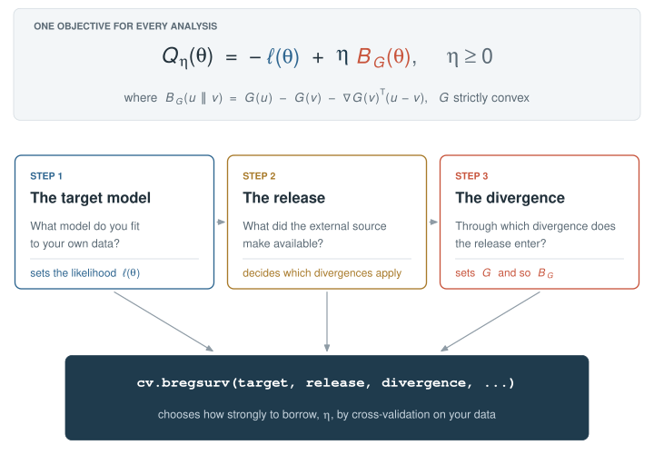

```{r setup, include = FALSE}
knitr::opts_chunk$set(collapse = TRUE, comment = "#>", warning = FALSE, message = FALSE,
                      fig.width = 7, fig.height = 4.2, dpi = 110, out.width = "100%",
                      fig.alt = "A plot drawn by plot() on a cv.bregsurv fit: the cross-validated loss along the integration weight, or predicted survival curves.")
```

`BregSurv` fits a time-to-event model to your data while borrowing from an external source. Every
analysis is one call with three ingredients: the **target** model you fit, the **release** the external
source published, and the **divergence** through which the release enters. `cv.bregsurv()` then chooses
how strongly to borrow, by cross-validation on your data.

```r
cv.bregsurv(target, release, divergence, ...)
```

{width=100%}

Every fit minimizes the objective at the top: the negative log-likelihood $\ell(\theta)$ of your data
plus an integration weight $\eta$ times a Bregman divergence $B_G$ between your model and the external
one. At $\eta = 0$ the external source is ignored; the larger $\eta$, the more you borrow. The three steps
below set the terms of the objective in turn: the target sets $\ell(\theta)$, the release decides which
divergences are possible, and the divergence sets $B_G$.

```{r}
library(BregSurv)
```

## Step 1: the target

The **target** is the model you fit to your own data; it sets the likelihood $\ell(\theta)$. You build it
with a constructor that takes your data, one row per subject, checks it (event indicators coded 0/1,
positive times, one case per matched set, no missing values), and stores it with the model's settings.
A constructor fits nothing. Which one to use depends on how your outcome was recorded.

### Follow-up time and an event indicator: a Cox model

`target_cox()` takes the observed times, the event indicator and the covariates, a numeric matrix or
data frame with one named column per covariate. `ExampleData_lowdim` is a simulated cohort of 100
patients with six covariates, and an independent test cohort of 2,000:

```{r}
data(ExampleData_lowdim)
tr <- ExampleData_lowdim$train
target_low <- target_cox(time = tr$time, event = tr$status, z = tr$z)
target_low
```

`ties =` sets how tied event times enter the likelihood ([below](#tied-event-times)), and `stratum =`
gives each stratum its own baseline hazard. `ExampleData_indi` holds a second cohort, of 500 patients
in ten strata (think of ten centres) with ten covariates; with the centre as the stratum, each centre
has its own baseline hazard and the covariate effects are shared:

```{r}
data(ExampleData_indi)
int <- ExampleData_indi$internal
target_int <- target_cox(time = int$time, event = int$status, z = int$z, stratum = int$stratum)
target_int
```

### Matched sets: a nested case--control design

`target_ncc()` takes the case indicator, the matched set of each row and the covariates. Every matched
set must hold exactly one case:

```{r}
data(ExampleData_cc_lowdim)
cc <- ExampleData_cc_lowdim$train
target_matched <- target_ncc(case = cc$y, set = cc$stratum, z = cc$z)
target_matched
```

### Follow-up recorded in intervals: a discrete-time model

`target_discrete()` takes the last interval each subject was at risk in, the event indicator (1 when the
event happened in that interval) and the covariates. `ExampleData_discrete` follows 150 patients over
six intervals, for instance years after transplant:

```{r}
data(ExampleData_discrete)
dt <- ExampleData_discrete$train
target_interval <- target_discrete(interval = dt$interval, event = dt$status, z = dt$z)
target_interval
```

The default link is the complementary log-log, under which the coefficients mean what a Cox model's do;
`link = "logit"` is also available.

### A neural-network risk score

A Cox or discrete-time target can replace the linear risk score $z^\top\beta$ by a neural network,
with `score = nn_score()`. Neural targets need the `torch` package and are described in
[Discrete-time and neural targets](discrete_neural.html):

```{r, eval = FALSE}
target_cox(time = tr$time, event = tr$status, z = tr$z, score = nn_score())
```

## Step 2: the release

The **release** is what the external source made available to you: individual records, a fitted
model with or without its uncertainty, a risk score without survival probabilities, or survival
probabilities. You do not choose it, but its form decides which divergences can use it in Step 3. A
release constructor stores it and checks it; covariates are matched to the target's by their names.

### Individual records

Another cohort's data, subject by subject, with the target's covariate names and outcomes in the
target's design: `time` and `event` for a Cox target, `case` and `set` for a matched design, `interval`
and `event` for a discrete-time target.

```{r}
ext <- ExampleData_indi$external
records <- release_records(ext$z, time = ext$time, event = ext$status, stratum = ext$stratum)
records

reg <- ExampleData_discrete$external
registry_records <- release_records(reg$z, interval = reg$interval, event = reg$status)
```

### A fitted model, with or without its uncertainty

A published model's coefficients, named by covariate; covariates the external model does not include
are set to 0. Its uncertainty, the precision matrix `Q` of the coefficients (the inverse of their
covariance matrix), is added when it was published. Below, the first model comes without its
uncertainty and the registry's with it:

```{r}
ExampleData_lowdim$beta_external_fair
published <- release_coef(ExampleData_lowdim$beta_external_fair)

registry_coef <- release_coef(ExampleData_discrete$beta_external, Q = ExampleData_discrete$Q_external)
registry_coef
```

### A risk score without survival probabilities

When the external model is available only as a risk calculator, which ranks patients by risk but gives
no survival probabilities, its score for each of your patients is the release, in the order of your
data. `ExampleData_lowdim$score_external$train` holds the scores a published calculator gives the 100
patients:

```{r}
calculator <- release_score(ExampleData_lowdim$score_external$train)
calculator
```

### Survival probabilities

An external model that gives survival probabilities, not only a ranking: its coefficients together
with its baseline cumulative hazard, whose increments over your intervals `baseline` holds (or, with
`hazard =`, its interval hazards for each of your patients directly). A discrete-time target needs this
form for the Kullback--Leibler divergence.

```{r}
registry_model <- release_model(beta = ExampleData_discrete$beta_external,
                                baseline = ExampleData_discrete$baseline_external)
registry_model
```

## Step 3: the divergence

The **divergence** is how the release enters the objective: the Bregman divergence $B_G$. There are three,
and each needs a different form of release:

| `divergence` | what it compares | the release it needs |
|---|---|---|
| `"kl"`: Kullback--Leibler | the distributions the two models predict for your subjects | the external model's predictions: a risk score, a fitted model or survival probabilities (on a discrete-time target, survival probabilities only) |
| `"mahalanobis"`: Mahalanobis | your coefficients with the external ones, weighted by their uncertainty (the Euclidean distance without it) | a fitted model, with or without its uncertainty |
| `"composite"`: composite likelihood | adds the external records' own log-likelihood, weighted by $\eta$ | individual records |

So the target and the release together decide which divergences are possible:

| release | Cox | nested case--control | discrete time |
|---|---|---|---|
| individual records | composite, mahalanobis, kl | composite | composite |
| a fitted model, with or without its uncertainty | kl, mahalanobis | kl, mahalanobis | mahalanobis |
| a risk score without survival probabilities | kl | kl | -- |
| survival probabilities | kl, mahalanobis | kl, mahalanobis | kl, mahalanobis |

Individual records also support the Mahalanobis and Kullback--Leibler divergences on a Cox target
because `cv.bregsurv()` can reduce them to a fitted model with its uncertainty, by fitting a Cox model
to them. A combination outside
the table is refused with an explanation. With the three ingredients chosen, `cv.bregsurv()` fits the
model along a grid of $\eta$, scores each $\eta$ by cross-validation on your data, and keeps the best.

### Cox model and a risk score without survival probabilities: Kullback--Leibler

The Kullback--Leibler divergence compares the two models through the probabilities they give each
patient of failing first at every event time, so the external model enters through its score alone, and
may be a model of any form.

```{r}
fit_score <- cv.bregsurv(target_low, calculator, divergence = "kl")
fit_score
```

The printout gives the selected $\eta$, the cross-validated loss at that $\eta$ (lower is better), the
estimator that did the fit (here `cv.coxkl`), and the coefficients. `plot()` draws the cross-validated
loss along $\eta$:

```{r, fig.alt = "Cross-validated loss against the integration weight for the risk-calculator example: the curve falls below the line of your data alone and reaches its minimum near eta = 1."}
plot(fit_score)
```

The dotted line is your data alone, $\eta = 0$. The curve dips below it: borrowing from the calculator
predicts your patients better than your data alone, and the red point marks the selected $\eta$.

The fit is used like any survival model, for instance to predict survival for new patients:

```{r}
te <- ExampleData_lowdim$test
predict(fit_score, newz = te$z[1:3, ], type = "survival", times = c(0.1, 0.2, 0.3))
plot(fit_score, type = "survival", newz = te$z[1:3, ])
```

### Cox model and a fitted model without its uncertainty: Kullback--Leibler or Mahalanobis

A fitted model supports two divergences; without its uncertainty, the Mahalanobis distance is the
Euclidean distance between the coefficients. Every call uses the same cross-validation partition (the
`seed` is fixed by default), so their losses, and the loss of your data alone, compare directly:

```{r}
fit_kl   <- cv.bregsurv(target_low, published, divergence = "kl")
fit_maha <- cv.bregsurv(target_low, published, divergence = "mahalanobis")
own      <- cv.bregsurv(target_low)
round(c(your_data_alone = own$value, kullback_leibler = fit_kl$value, mahalanobis = fit_maha$value), 3)
```

The coefficient plot shows what borrowing did to each coefficient: from your data alone (open circle)
toward the published value (triangle), to the selected fit (filled circle).

```{r, fig.height = 3.9, fig.alt = "For each covariate, the coefficient from your data alone, the published coefficient, and the selected fit, with arrows showing how borrowing moved each coefficient toward the published one."}
plot(fit_maha, type = "coefficients")
```

### Cox model and another cohort's individual records: composite likelihood

The individual records enter with their own likelihood, weighted by $\eta$: the two cohorts share the
coefficients and keep their own baseline hazards.

```{r}
fit_comp <- cv.bregsurv(target_int, records, divergence = "composite")
fit_comp$eta
plot(fit_comp)
```

Here the external cohort comes from the same population as yours, so the loss keeps falling as $\eta$
grows and the largest weight is selected. The same records can also enter as a fitted model with its
uncertainty:

```{r}
fit_records_maha <- cv.bregsurv(target_int, records, divergence = "mahalanobis")
own_int <- cv.bregsurv(target_int)
round(c(your_data_alone = own_int$value, composite = fit_comp$value,
        mahalanobis = fit_records_maha$value), 3)
```

### Nested case--control design and a fitted model: Kullback--Leibler

On a matched design the Kullback--Leibler divergence compares the two models' probabilities of which
member of each set is the case, and the cross-validated loss is the conditional log-likelihood:

```{r}
fit_matched <- cv.bregsurv(target_matched, release_coef(ExampleData_cc_lowdim$beta_external),
                           divergence = "kl")
fit_matched
plot(fit_matched)
```

### Discrete time and survival probabilities: Kullback--Leibler

On a discrete-time target the Kullback--Leibler divergence compares the two models' hazards in every
interval, so it needs the registry's survival probabilities:

```{r}
fit_interval <- cv.bregsurv(target_interval, registry_model, divergence = "kl")
fit_interval
plot(fit_interval)
plot(fit_interval, type = "survival", newz = ExampleData_discrete$test$z[1:3, ])
```

The registry's fitted model, with its uncertainty, and its individual records support the other two
divergences on the same target, and every discrete-time fit is scored by the same held-out
log-likelihood:

```{r}
fit_interval_maha <- cv.bregsurv(target_interval, registry_coef, divergence = "mahalanobis")
fit_interval_comp <- cv.bregsurv(target_interval, registry_records, divergence = "composite")
own_interval <- cv.bregsurv(target_interval)
round(c(your_data_alone = own_interval$value, kullback_leibler = fit_interval$value,
        mahalanobis = fit_interval_maha$value, composite = fit_interval_comp$value), 3)
```

## Further topics

### Many covariates: a penalty

`penalty = "lasso"` (or `"ridge"`, or `"enet"` with `alpha`) penalizes the coefficients. A penalty path
is built for every $\eta$ and the two are chosen together; the curve shows each $\eta$ at its best
penalty. `ExampleData_highdim` has 50 covariates for 200 patients, of which six matter:

```{r}
data(ExampleData_highdim)
hd <- ExampleData_highdim$train
target_hd <- target_cox(time = hd$time, event = hd$status, z = hd$z)
fit_lasso <- cv.bregsurv(target_hd, release_coef(ExampleData_highdim$beta_external),
                         divergence = "kl", penalty = "lasso")
c(eta = fit_lasso$eta, lambda = fit_lasso$lambda, nonzero = sum(coef(fit_lasso) != 0))
plot(fit_lasso)
```

```{r, fig.height = 4.6, fig.alt = "Coefficients of the first twelve covariates under the lasso: your data alone, the external coefficients, and the selected fit."}
plot(fit_lasso, type = "coefficients", covariates = paste0("Z", 1:12))
```

### Tied event times

When follow-up is recorded on a coarse grid, as at scheduled visits, many events share a time.
`ExampleData_ties` holds such a cohort. `ties = "breslow"` uses Breslow's approximation for the tied
times, with every divergence and penalty; `ties = "exact"` uses Cox's exact likelihood, with the
Kullback--Leibler divergence and no penalty.

```{r}
data(ExampleData_ties)
ti <- ExampleData_ties$train
target_ties <- target_cox(time = ti$time, event = ti$status, z = ti$z, ties = "breslow")
target_ties
fit_ties <- cv.bregsurv(target_ties, release_coef(ExampleData_ties$beta_external), divergence = "kl")
fit_ties$eta
```

### A fit at a given weight

`bregsurv()` takes the same ingredients and fits at an $\eta$ you choose, without cross-validation:

```{r}
fit_eta1 <- bregsurv(target_low, published, divergence = "kl", eta = 1)
coef(fit_eta1)
```

### The estimators behind the call

On a linear target, `cv.bregsurv()` hands the fit to one of the package's estimators, named in its
`engine` (for example `cv.coxkl`, `cv.discrete_MDTL`, `cv.ncckl`), and returns exactly its result in
`fit`. The estimators can be called directly for options the interface does not expose, such as
stability selection and bagging; see [The estimators behind each divergence](engines.html).

## Where to go next

* [The framework](framework.html): the objective, and why each release supports the divergences it does.
* [The help page of `cv.bregsurv()`](../reference/cv.bregsurv.html): every argument, and the estimator
  each combination calls.
* [Discrete-time and neural targets](discrete_neural.html).
* [The estimators behind each divergence](engines.html).
